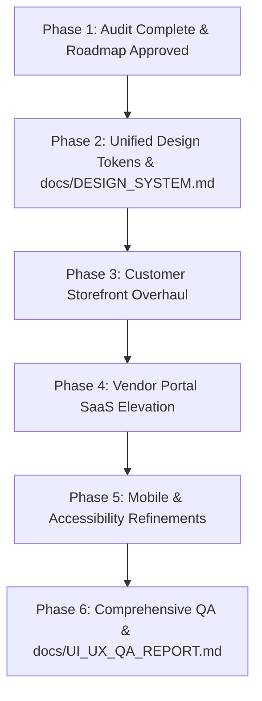

# ShopFlow — Comprehensive UI/UX Audit & Redesign Roadmap

**Date**: November 20, 2026  
**Auditor**: Principal UI/UX Designer & Senior Frontend Engineer  
**Live Application**: [https://shoppingflow.vercel.app/](https://shoppingflow.vercel.app/)  
**Design Reference**: [Aceternity Design & Development Studio Template](https://ui.aceternity.com/templates/design-development-studio-template)  

---

## 1. Executive Summary

ShopFlow is an established, zero-commission hyperlocal multi-vendor commerce platform that connects local neighbourhood retail merchants with nearby shoppers. It offers digital storefronts, in-store POS, zero-fee direct merchant UPI payments, counter pickup ID verification, and order lifecycle management.

While the underlying business logic, state machines, and backend contracts are functional, the user interface currently exhibits visual fragmentation, inconsistent component tokens, arbitrary border radii, and utilitarian layout structures. 

This audit establishes the baseline for a complete **production-quality UI/UX redesign** inspired by the refined, high-trust aesthetic of **Aceternity UI** (clean hairline borders, deliberate typography, subtle micro-interactions, cohesive semantic tokens, and high-contrast accessibility), while strictly preserving all existing functionality and backend integrations.

---

## 2. Complete Existing Page & Route Inventory

| Route | Page Component | Role | Functional Scope & Backend Integration | Audit Status |
| :--- | :--- | :--- | :--- | :--- |
| `/` | `Home.jsx` | Public | Public hero, role switcher, value proposition, quick entry to Customer or Vendor flows. Auto-redirects logged-in users. | Implemented; needs visual elevation to Studio caliber |
| `/customer/login` | `CustomerLogin.jsx` | Customer Auth | Mobile & password auth, input validation, role validation, direct admin portal single link. | Implemented; functional |
| `/customer/register` | `CustomerRegister.jsx` | Customer Auth | Mobile registration, OTP verification via SMS/dev OTP, password strength check. | Implemented; functional |
| `/customer/forgot-password` | `CustomerForgotPassword.jsx`| Customer Auth | Mobile lookup, OTP delivery, password reset. | Implemented; functional |
| `/customer/dashboard` | `CustomerDashboard.jsx` | Customer | Order history table, active pickup ID banner, digital receipt modal, profile editing, phone/email OTP update, password change, account deletion. | Implemented; complex monolithic component |
| `/shops` | `ShopDiscovery.jsx` | Customer | GPS-based store detection strictly within 2 km radius, search by store name/number, shop cards with range tags. | Implemented; functional |
| `/shops/:shopId` | `ShopStorefront.jsx` | Customer | Shop profile, category filter pill bar, search, product grid, slide-out cart drawer, single-vendor cart enforcement, direct UPI modal, Cash order, bill modal. | Implemented; high traffic core flow |
| `/vendor/login` | `VendorLogin.jsx` | Vendor Auth | Mobile & password auth, error alerts, single admin portal link at bottom. | Implemented; functional |
| `/vendor/register` | `VendorRegister.jsx` | Vendor Auth | Merchant onboarding, mobile OTP verification, password setup. | Implemented; functional |
| `/vendor/forgot-password` | `VendorForgotPassword.jsx` | Vendor Auth | Password recovery via mobile OTP. | Implemented; functional |
| `/vendor/register-shop` | `ShopRegistration.jsx` | Vendor | Onboarding step for new vendors: shop name, category dropdown, address, contact, mandatory UPI ID, GPS detection. | Implemented; functional |
| `/vendor/dashboard` | `VendorDashboard.jsx` | Vendor | Sales & profit metrics (Today, Week, Month, Total), channel breakdown (Online vs Walk-in), inventory alerts, notifications dropdown with click-outside dismiss, shop & profile editing. | Implemented; high-value operational dashboard |
| `/vendor/orders` | `VendorOrders.jsx` | Vendor | Structured order pipeline (`ALL`, `PENDING_PAYMENT`, `AWAITING_PICKUP`, `COMPLETED`), manual UPI verification with UTR prompt/check, pickup verification, cancellation. | Implemented; operational core |
| `/vendor/products` | `Products.jsx` | Vendor | Product catalogue table, search & category filters, stock level inline adjusters, packaging unit dropdown, add/edit product modal. | Implemented; dense operational UI |
| `/vendor/categories` | `Categories.jsx` | Vendor | Category management, 40+ standard retail preset dropdown, custom category addition, product counts, delete/edit actions. | Implemented; functional |
| `/vendor/pos` | `WalkInPos.jsx` | Vendor | Counter sales POS, fast product tap-to-add, walk-in cart, cash/UPI payment toggling, instant receipt printing. | Implemented; high utility |
| `/admin/login` | `AdminLogin.jsx` | Admin Auth | Secure administrative login without autofill credentials. | Implemented; secure |
| `/admin/dashboard` | `AdminDashboard.jsx` | Admin | High-level platform statistics, customer & shop suspension controls, dispute/report review system with admin notes, admin password update. | Implemented; dark theme |

---

## 3. Existing Component & Shared Architecture Inventory

### UI Primitives (`src/components/ui/`)
- `button.jsx`: `class-variance-authority` (cva) button with default, destructive, outline, secondary, ghost, link, success, subtle variants.
- `badge.jsx`: Semantic status badges (default, secondary, destructive, outline, success, warning, info, purple).
- `card.jsx`: Card wrapper with CardHeader, CardTitle, CardDescription, CardContent, CardFooter.
- `dialog.jsx`: Modal dialog with fixed backdrop and basic click-outside listener.
- `input.jsx`: Basic styled text input with standard border.
- `table.jsx`: HTML table wrapper primitives with TableHeader, TableRow, TableHead, TableCell.
- `tabs.jsx`: Simple tab switcher based on context.
- `textarea.jsx`: Basic multi-line text input.
- `alert.jsx`: Alert container and description.

### Domain & Composite Components (`src/components/`)
- `ShopFlowRoleLogo.jsx`: Unified brand logo with role badge (`CUSTOMER`, `VENDOR`, `ADMIN`). Handles reload on current home page or navigation to role home page with dirty state confirmation.
- `BillModal.jsx`: Itemized invoice modal with print engine and printable iframe support.
- `ReportIssueModal.jsx`: Report and dispute submission modal.
- `AuthLayout.jsx`: Two-column auth layout with split brand banner and card form.
- `ErrorBoundary.jsx`: React error boundary for runtime recovery.
- `CartContext.jsx`: Single-vendor client cart store with localStorage synchronization and multi-shop conflict resolution.

---

## 4. Visual Inconsistencies & UX Friction Points

### A. Visual Tokens & Styling Gaps
1. **Border Radius Fragmentation**: Elements arbitrarily alternate between `rounded-lg` (8px), `rounded-xl` (12px), `rounded-2xl` (16px), and `rounded-3xl` (24px) without a disciplined token hierarchy.
2. **Color Palette Dispersion**:
   - Multiple competing shades of blue (`#2563eb`, `bg-blue-600`, `text-blue-700`, `bg-blue-50/70`) and emerald (`#10b981`, `bg-emerald-600`, `bg-emerald-50`).
   - Admin portal operates on an isolated dark theme (`bg-slate-950`), while customer and vendor portals operate on bright light backgrounds with varying border grays (`border-slate-200`, `border-slate-100`, `border-neutral-200`).
3. **Typography & Tabular Numerics**:
   - Currency (`₹`), order quantities, and pickup codes frequently lack tabular alignment (`tabular-nums` / `font-mono`), causing visual jitter during stock incrementing and cart calculations.
   - Heading scales jump abruptly between page hero banners and operational card tables.
4. **Card Depth & Elevation**:
   - Current cards rely on standard Tailwind shadow utilities (`shadow-sm`, `shadow-md`, `shadow-2xs`).
   - Aceternity-style hairline borders (`border-neutral-200/80` with subtle hover sheen and micro-highlights) are absent.

### B. Customer Storefront Friction Points
1. **Shop Discovery (`/shops`)**:
   - If GPS permission is pending or denied, the fallback state could provide clearer visual guidance and search feedback.
   - Shop cards display basic metadata but lack refined visual hierarchy (distance indicator, open badge, product preview summary).
2. **Storefront & Product Catalog (`/shops/:shopId`)**:
   - Sticky mobile cart bar and category pills need higher touch targets (>= 44x44px).
   - In-shop product cards lack subtle hover borders and consistent aspect-ratio image containers.
3. **Customer Orders (`/customer/dashboard`)**:
   - Orders list is rendered in a wide desktop table that requires awkward horizontal scrolling on mobile screens.
   - Active Pickup ID banner could be elevated into a prominent, high-contrast security badge for swift counter presentation.

### C. Vendor Portal Friction Points
1. **Operational Density vs Clarity**:
   - `VendorDashboard.jsx` contains metrics, recent sales, quick actions, and an inline profile/shop editor in one long screen.
   - Top metrics (Sales vs Profits across Today, Week, Month, Total) deserve an elegant bento-grid layout with clear visual grouping.
2. **Order Fulfillment Pipeline (`/vendor/orders`)**:
   - High-volume order verification needs clear visual distinction between orders awaiting manual UPI confirmation and those ready for counter pickup.
   - Quick action buttons (Verify Payment, Complete Order) must be immediately identifiable without cognitive clutter.
3. **Product Inventory (`/vendor/products`)**:
   - Unit selector dropdown and stock adjustments need clean inline touch ergonomics.

---

## 5. Accessibility Audit (WCAG 2.2 AA)

1. **Contrast Ratios**: Certain muted metadata labels (`text-slate-400` on white card backgrounds) provide ~3.1:1 contrast, falling below the mandatory 4.5:1 ratio for normal text. These must be upgraded to accessible neutral zinc/slate tokens (`text-slate-600` or `text-zinc-600`).
2. **Keyboard Navigation & Focus Indicators**:
   - Many custom buttons and interactive div elements lack prominent `focus-visible:ring-2` focus outlines.
   - Modal focus trapping and `Esc` key dismissal need uniform enforcement.
3. **Touch Targets (Mobile Viewports)**:
   - Several quantity stepper buttons (`+` / `-`) on mobile screens measure ~28x28px, below the WCAG recommended 44x44px touch target area.
4. **Screen Reader Semantics**:
   - Icon-only buttons (notification bell, delete icon, copy button) require unambiguous `aria-label` attributes.

---

## 6. Critical Business Logic & Functional Invariants (DO NOT BREAK)

1. **Zero Third-Party Gateway Dependency**: Direct vendor UPI and cash on pickup remain the sole supported payment models.
2. **Manual UPI Verification Rule**:
   - Customers provide UPI transaction references (UTR).
   - Orders remain in `AWAITING_PICKUP` with `paymentStatus: PENDING` until the vendor manually confirms receipt in `/vendor/orders`.
   - Pickup ID is released to the customer only after vendor verification.
3. **Strict 2 km Proximity Filter**: `ShopDiscovery.jsx` and backend `shopController.js` must never dump all shops; GPS or explicit search query is strictly required.
4. **Single-Vendor Cart Rule**: `CartContext.jsx` enforces single-shop cart purity with an explicit multi-shop replacement confirmation prompt.
5. **Real Financial & Profit Calculations**: All metrics (Today's Sales, Weekly/Monthly/Total Profit, cost price vs selling price) use real backend API calculations.
6. **Print Receipt Engine**: `BillModal.jsx` print layout and SVG icon constraints must remain intact.
7. **Role Navigation & Unsaved Work Protection**: `ShopFlowRoleLogo.jsx` reload and dirty-state confirmation must be preserved.

---

## 7. Aceternity-Inspired Design Direction

### Visual Principles:
- **Clean Canvas**: Light-first warm neutral canvas (`#FAFAFA` / `#F8FAFC`) with crisp white elevated cards (`#FFFFFF`).
- **Hairline Borders**: 1px subtle neutral borders (`border-neutral-200/80` or `border-slate-200/90`) with delicate hover state transitions (`hover:border-neutral-300`).
- **Subtle Grids & Sheen**: Minimalist micro-dot or hairline grid accents in hero sections without performance overhead.
- **Micro-Badges**: Pill-style badges with solid status dots (e.g. green pulse for verified, amber for pending UPI).
- **Tabular Precision**: `font-mono tabular-nums` for all currency amounts (₹), quantities, order IDs, and pickup codes.
- **Fast Operations**: No sluggish animations on operational vendor buttons, tables, or inputs.

---

## 8. Prioritized Implementation Roadmap

### Phase 2: Design Tokens & Primitive Standardization
- Establish `docs/DESIGN_SYSTEM.md`.
- Standardize Tailwind configuration with Aceternity-inspired semantic tokens (canvas, surface, borders, primary accent, status scales).
- Elevate core primitives: `Button`, `Badge`, `Card`, `Input`, `Dialog`, `Table`, `Tabs`, `Skeleton`.

### Phase 3: Customer Storefront Experience
- Elevate `Home.jsx` with an Aceternity Studio caliber hero, refined feature bento-grid, and role switchers.
- Modernize `ShopDiscovery.jsx` with sleek GPS radar status and elevated store cards.
- Refine `ShopStorefront.jsx`: sticky mobile cart, clean category pill carousel, and crisp UPI payment modal.
- Polish `CustomerDashboard.jsx`: mobile-friendly card views for orders and high-contrast Pickup ID presentation.

### Phase 4: Vendor Portal SaaS Elevation
- Redesign `VendorDashboard.jsx` metrics into a clean, modern Bento Grid displaying sales and profits.
- Streamline `VendorOrders.jsx` with pipeline status chips and instant UPI verification actions.
- Enhance `Products.jsx` and `Categories.jsx` with clean data tables and inline stock adjusters.
- Polish `WalkInPos.jsx` for fast, tactile retail billing.

### Phase 5: Mobile & Accessibility Refinements
- Enforce 44px touch targets across all steppers and mobile actions.
- Verify WCAG 2.2 AA contrast compliance across all text and badge variants.
- Test responsive viewports: 360px, 390px, 768px, 1024px, 1440px.

### Phase 6: Verification & QA
- Zero-error Vite build check.
- Complete functional verification across customer and vendor flows.
- Publish `docs/UI_UX_QA_REPORT.md`.
